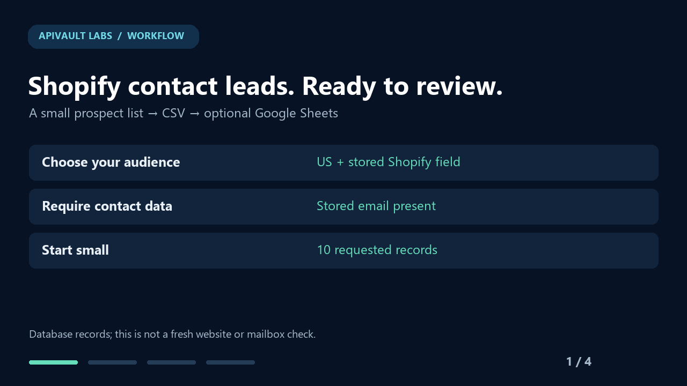

# Shopify contact leads → CSV or Google Sheets

Build a small, reviewable ecommerce prospect list, then export it in the format your team uses.

**Start with 10 records.** This guide uses the hosted [Shopify & WooCommerce website database](https://apify.com/apivault_labs/website-leads-database). It selects US records from the Shopify source segment, requires a stored email, and filters the stored ecommerce-platform field for Shopify. These are database records; the workflow does not perform a fresh website or mailbox verification.

## Get the files

- [Manual n8n workflow](shopify-leads-to-sheets.json)
- [Actor input](actor-input.json)
- [Google Sheets headers](sheet-headers.csv)
- [Illustrative CSV preview](example-preview.csv) — deliberately synthetic, not a customer export
- [32-second animated walkthrough](workflow-walkthrough.gif) — an explanatory animation, not a live screen recording

No community-node installation is required. The template uses built-in n8n nodes, is inactive, and contains no credentials or schedule.

## Fast path: CSV from Apify

1. Open the [Actor](https://apify.com/apivault_labs/website-leads-database).
2. Switch the input to JSON and paste [actor-input.json](actor-input.json).
3. Review the current price and spending limit in Console, then start the run.
4. Once it finishes, inspect the run's `SUMMARY` record and Dataset. Download CSV from the Dataset export menu.

One website record is one result, even when its email or phone field contains several semicolon-separated values. An upper limit of 10 is not a guarantee of 10 matching records. The database's 69M+ positioning refers to the overall historical website inventory, not 69M Shopify stores or contacts.

## Use the n8n template

1. Download the workflow JSON using GitHub's **Raw / Download raw file** control.
2. In n8n, import the JSON into a new workflow.
3. Create an **HTTP Header Auth** credential with header name `Authorization` and value `Bearer YOUR_APIFY_TOKEN`. Select it on all six HTTP Request nodes. Keep the real token in n8n credentials, not in the workflow JSON or a public spreadsheet.
4. Open **Configure export**. The default is a manual, 10-record US sample with a $0.15 event cap. Actor platform costs, if applicable, are separate. The template uses the checked `0.17.5` build; review the current contract before changing this pin.
5. Leave `sendToGoogleSheets: false` for the first test. Execute manually and download the generated file from **Download CSV**.
6. For another audience, change the country or filters and review the spending cap before creating another run. Keep `maxItems` between 1 and 1,000 in this template.

The template creates at most one Actor run per manual new-export execution. It polls that run, checks source coverage, verifies the Dataset count, then reads at most 1,000 rows. It does not automatically retry the paid POST.

## Connect Google Sheets

CSV works without Google credentials. To add Sheets delivery:

1. Create your own spreadsheet with a tab named `Leads`.
2. Paste the single line in [sheet-headers.csv](sheet-headers.csv) into its first row, splitting on commas if needed.
3. Select your Google Sheets OAuth credential on **Upsert by domain** and replace `REPLACE_WITH_SPREADSHEET_ID` with your spreadsheet ID.
4. Set `sendToGoogleSheets: true` in **Configure export**.
5. Execute manually. The Sheets node is configured to append or update using `domain` as its matching column and to send literal values using RAW formatting.

Use a separate tab for a separate campaign. Do not overlap writes to the same sheet or assume this configuration provides a transaction across Apify and Google. Connecting your Google account is your setup step; the published template contains no shared credentials.

## Understand the columns

| Column | Meaning |
|---|---|
| `domain` | Normalized stored root domain and Sheets match key |
| `company` | Company name when known |
| `emails` | Stored email values; not mailbox-deliverability verification |
| `phones` | Stored telephone values; not a live telephone/WhatsApp check |
| `country` | Stored country value |
| `ecommerce_platform` | Stored platform field; not a fresh technology scan |
| `last_found` | Source field when available; blank means unknown |
| `source_status` | Status from the Actor's `SUMMARY` |
| `export_scope` | Whether this is a capped sample or a completed matching export |

CSV values starting with spreadsheet formula characters are prefixed with an apostrophe. This also preserves phone prefixes when opening the CSV in a spreadsheet. The Sheets branch uses RAW values without that CSV-only prefix.

## Recover without another paid export

If downloading or writing to Sheets fails after the Actor has started:

1. Copy the run ID from **Start Actor** or Apify Console.
2. Paste it into `resumeRunId` in **Configure export**.
3. Execute manually. The recovery branch reads that existing run and skips **Start Actor**.
4. Clear `resumeRunId` only when you deliberately want a new paid export.

The recovery run must belong to this Actor, and its Dataset must contain no more than 1,000 records. This workflow does not create a new run just to check a status or retry a download. It does not provide global idempotency between two independently started n8n executions.

## Empty, capped and partial results

- `MAX_ITEMS_REACHED` is a normal capped sample. The CSV/Sheet includes `limited_sample`; it is not a full audience export.
- A healthy empty result writes no Sheet rows and produces no CSV file in n8n. Inspect `SUMMARY` for `NO_RESULTS`.
- Source errors, missing summary fields, spending-limit stops and inconsistent Dataset counts stop the workflow for review. Inspect the same run's `SUMMARY`, `ERRORS` and Dataset before deciding what to do next.
- Dataset sizes above 1,000 are rejected to prevent silent truncation. Use the paginated API for larger exports.
- Polling stops after 15 minutes while a run is pending. Review the saved run instead of starting another one automatically.

## What was checked

On **16 October 2026**, one owner-funded production run using the exact sample input returned **10 unique records**. All 10 had stored email and phone fields, US country values and Shopify in the stored ecommerce-platform field. Charged result events: **10**. This small check is not a coverage guarantee for other filters, sources or future dates.

Runtime validation and its exact scope are recorded in [VALIDATION.md](VALIDATION.md). The animation illustrates the input, checked sample and delivery paths; its preview rows are synthetic. A connected Google Sheets write requires the customer's OAuth setup and is recorded separately from CSV/runtime checks.

## Want advertising evidence too?

Use [Shopify Advertiser Leads Finder](https://apify.com/apivault_labs/shopify-advertiser-leads-finder) for a separate workflow linking observed active ads to a live Shopify storefront and available public contacts. Its discovery limits and source availability differ from the database export above.

Questions or a missing field? Open an issue on the relevant Actor and include the run ID, input goal and expected output. Keep tokens and private customer records out of public issues.
